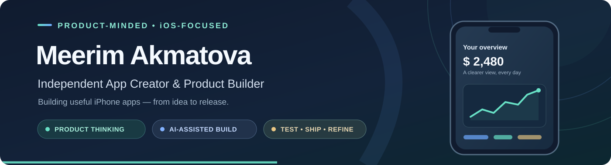

  

  <a href="https://apps.apple.com/us/app/akcha-flow/id6820887964">Akcha Flow on the App Store</a>
  &nbsp;·&nbsp;
  <a href="mailto:kgleader@gmail.com">Contact</a>

---

### Hello, I'm Meerim 👋

I'm an independent app creator based in the Chicago area. I bring together **product thinking, UX, AI-assisted development, and hands-on testing** to turn ideas into useful iPhone apps.

### Featured work

**💸 [Akcha Flow](https://apps.apple.com/us/app/akcha-flow/id6820887964)** · **Available on the App Store**

A privacy-focused personal finance app for iPhone, built with **SwiftUI** and **SwiftData**.

**[Explore the app →](https://apps.apple.com/us/app/akcha-flow/id6820887964)**

### Focus & tools

**Focus:** Product planning · UX · AI-assisted iOS development · Testing · App Store releases

**Tools:** `SwiftUI` · `SwiftData` · `Xcode` · `Git` · `GitHub` · `XCTest`

**Learning:** Deepening my Swift, iOS architecture, and automated testing skills.

---

  <em>Building, learning, and improving — one release at a time.</em>

